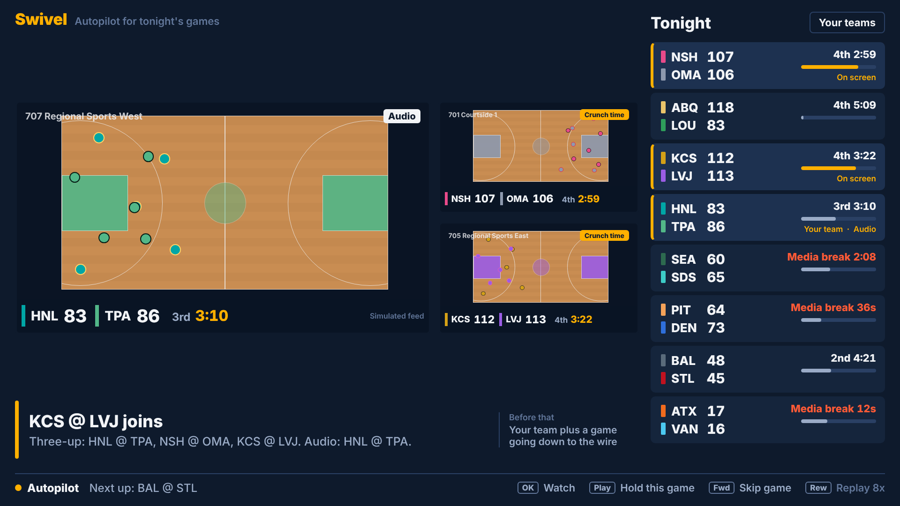
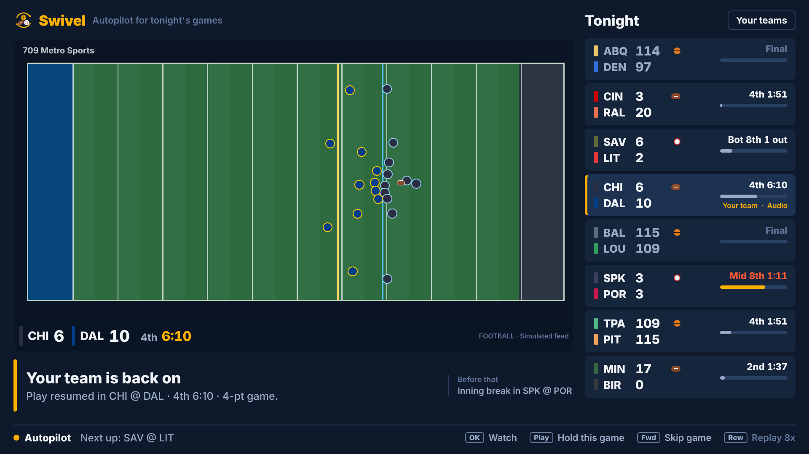
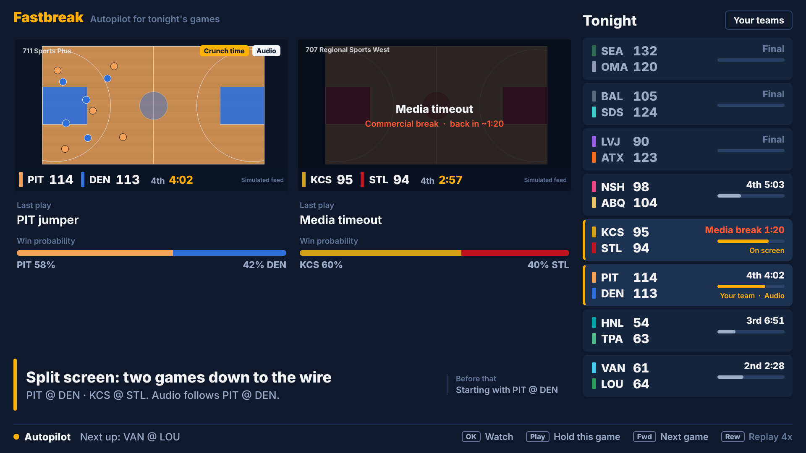

# Swivel

**Autopilot for a night of live sports on Fire TV: basketball, football and baseball.** When your game goes to commercial, Swivel moves you to the best game that's live. When play resumes, it brings you back. When two or four games go down to the wire at once, it splits the screen automatically.

NBA CrunchTime and NFL RedZone are one channel for everyone. Swivel is personal: built around your teams, across your own lineup, with no commercials.

Built for the Amazon Developer Hackathon (Fire TV track) on **Vega OS** with React Native. The same code also runs in a browser for quick iteration.



| Your team, full screen | Split: your team plus a close finish |
|---|---|
|  |  |

## What it does

- **Your team first.** When one of your teams is live, you're on it, unless it's a blowout. When your team comes back from a break, you go back immediately. In multiview, your team always gets the big tile and the audio. (The "Your teams" screen also offers *Balanced* and *Best game on*.)
- **Commercials leave the screen.** When your game breaks for a timeout, media timeout, quarter break or halftime, Swivel moves you to the best live game. In split, three-up or quad, a game on a timeout keeps its tile under a "Back in" card while the audio moves to live action, so the grid doesn't jump around. Longer breaks (quarter, halftime) take the game out of the grid until play resumes. Replay reviews stay on screen, since they're game action.
- **No guessed countdowns.** Break lengths vary (media timeouts run about 1:50–3:50), so Swivel never invents one. It shows how long the break has run and watches the play-by-play feed for play to resume. Because the feed is 25–55 s ahead of the broadcast, it knows play is back *before your stream does*, which gives a real countdown ("Back in 0:18") and a switch timed to the moment the video returns.
- **Won't hop into a commercial.** If another game's feed already shows a timeout your stream hasn't reached, that game is skipped. While a break lasts, it prefers games that will still be live when the break ends.
- **Finds tight games.** A closed-form win-probability model scores how much each possession swings the outcome (leverage). Split, three-up and quad kick in when games are in crunch time, with your team included.
- **Seamless, not twitchy.** After any change, optional moves (upgrades, new tiles, entering multiview) wait 45 s. It won't hop away when the feed shows play resuming within 45 s, won't add a tile whose break is already on the way, picks fill-in games that are unlikely to break soon, and goes straight back to your team if a fill-in breaks just before your team returns. Plus the basics: minimum time on a game, a margin a new game must beat, and hysteresis on crunch time. `scripts/seamless.ts` measures it over 40 simulated nights: screens that last under a minute dropped from 3.1 to 1.4 per hour.
- **Learns from your remote.** Picking a game (OK) counts toward the teams in it (leaning toward the one you already like, so it can tell "likes this team" from "liked this game"), skipping one (Fast-forward) counts against it, and holding one (Play/Pause) counts for it. Which way you move, toward tight games or back to your teams, tunes how much drama outweighs loyalty. This runs entirely on the device: no account, no network. It says what it learned ("Learned: you like LOU"), shows it on the Your teams screen, and you can make it forget.
- **What you missed.** Every switch carries a one-line catch-up generated from the play-by-play since you last saw that game: *"While you were away, 4:45: LVJ cut a 10-point lead to 1."* For a game you haven't seen yet, it's *"How we got here."* It picks the one storyline that matters (a lead change, a comeback, a run, a team pulling away) and stays silent when you only missed a commercial. Rules over play-by-play, no LLM, so it works offline and never makes up a play.
- **Explains itself.** Every switch shows a reason, for example *"HNL @ TPA went to commercial. Full screen: KCS @ LVJ, 4th 2:52, 1-pt game."*

### Three sports, one autopilot

Hops, multiview, learning and recaps are shared; each sport plugs in its own rules through a `Sport` (`packages/director/src/sports/`):

| | Basketball | Football | Baseball |
| --- | --- | --- | --- |
| Clock | 4 x 12:00 | 4 x 15:00, 10:00 sudden-death OT | none: half-innings, outs, runners |
| Commercials | timeouts, media timeouts (7:00 / 3:00 windows), quarter breaks, halftime | TV timeouts after scores, kickoffs and some changes of possession, the two-minute warning, quarter breaks, halftime | every half-inning, mid-inning pitching changes |
| Win probability | margin + time | margin + time + the drive in progress (expected points from field position) | margin + innings left + the base-out state (RE24 run expectancy) |
| Crunch time | 4th quarter / OT, high leverage | 4th quarter / OT, high leverage | 8th inning on, high leverage (a one-run 9th) |

Football's "double-dip" (score, commercial, kickoff, commercial) is handled: Swivel waits out the second break instead of returning for 25 seconds of kickoff. The demo night mixes all three. The rail marks each game's sport, the tile draws a court, a field (ball at the line of scrimmage) or a diamond (occupied bases lit), and the Your teams screen lists tonight's teams.

### Why not computer vision for break detection?

We considered detecting commercials from the picture (scorebug present or not, court colors). On Fire TV, premium live sports are DRM-protected and decoded on a secure path, so an app can't read those frames, even in its own player. The feed-lead approach above is more accurate anyway: it knows about breaks and resumptions *earlier* than the picture shows them. Vision does fit one job on the platform side: automatically calibrating each channel's delay by reading the scorebug clock. That's on our feature-request list for the Fire TV team.

### Known limits

- **Channel delay is the main production risk.** The two-view model is only as good as each channel's delay, which the simulator fixes per channel (25–55 s). On real TV it varies by provider, device and stream, and a wrong value means switching early (catching the end of a commercial) or late (missing a few seconds of play). The plan is to calibrate it per channel by comparing HLS `EXT-X-PROGRAM-DATE-TIME` against feed timestamps.
- **Feeds report "play resumes" late.** Real feeds often publish it 5–15 s after it happens, while the simulator is perfectly timed by default. Replay with `?lag=5-15` on web (or `resumeLagMs` in `demoConfig.ts`) to see the honest version: "Back in" countdowns get shorter because Swivel hears about the resume later. On real TV the switch back would also land up to that many seconds after the video resumes, since the engine can only time it from the report.

## Remote

| Button | Action |
| --- | --- |
| Up / Down | Browse tonight's games (first press shows focus) |
| OK on a game | Watch it (autopilot still covers its breaks) |
| OK on "Your teams" | Pick favorites, likes, loyalty, split/quad on/off |
| Left into the video | Pick a tile in split/quad; OK makes it full screen |
| Play/Pause | Hold this game (pause autopilot) |
| Fast-forward | Skip this game (Swivel learns from it) |
| Rewind | Demo only: cycle replay speed |

On web: arrow keys, Enter, Space (Play/Pause), `]` (Fast-forward), `[` (Rewind), Esc (Back).

## How it works

```
packages/director      pure TypeScript engine, no platform deps (unit tested)
  gameState.ts         play-by-play reducer; feed view vs. on-screen view per channel delay
  sports/              per-sport rules: win probability, leverage, breaks, labels (basketball, football, baseball)
  winprob.ts           basketball win probability + leverage index
  breakModel.ts        stoppage durations, break hazard (media-timeout windows, runs, late game)
  director.ts          the policy: break hops, anchor/return, upgrades, must-see, split/quad, audio
  lineup.ts            LineupSource / PlaybackController interfaces (EPG + data feed adapters)
  sim/                 deterministic simulators for three fictional leagues (possessions, plays, plate appearances)
packages/shared-ui/src/swivel   the 10-foot UI (stage, tiles, game rail, caption, teams)
apps/vega              Vega OS app shell
apps/expo-multi-tv     web / Android TV shell (used for fast iteration)
```

**On a real device**, `LineupSource` is built from the Vega **EPG Provider** (which channels in your lineup carry tonight's games) plus a licensed sports data feed. `PlaybackController` maps the primary slot to **Vega Channel Tuning**, with additional players for multiview tiles. The demo replays a simulated slate so it carries no league footage or data rights. Teams are fictional, and video tiles are a rendered "broadcast" driven by the feed.

## Run it

Prerequisites: Node 18+, Yarn 4 (`corepack enable`), and for Vega the Vega SDK (`vega --version`) with Java 21+.

```bash
yarn install

# Vega OS (Vega Virtual Device)
vega virtual-device start
yarn build:vega
vega run-app apps/vega/build/aarch64-release/*_aarch64.vpkg -d VirtualDevice   # x86_64 on Intel Macs

# Web (fast iteration)
yarn dev:web            # http://localhost:8082/?seed=74&speed=8

# Engine tests and tools
cd packages/director
npx tsx --test test/*.test.ts
npx tsx scripts/runHeadless.ts 51 TPA    # print every decision over a full night
npx tsx scripts/findSlate.ts 1 200       # search for demo-worthy nights
npx tsx scripts/findDemo.ts 1 150        # search nights x favorite teams for the best demo
npx tsx scripts/seamless.ts 40           # count flashes and short-lived screens over 40 nights
SPORTS=nba,nfl,mlb npx tsx scripts/runHeadless.ts 65 DAL   # any script, on a mixed night
npx tsx scripts/findMixedDemo.ts 1 80   # search mixed nights for the best 3-sport demo window
```

Demo knobs are in `packages/shared-ui/src/swivel/demoConfig.ts`. The default is night `65` with basketball, football and baseball, Dallas football as your team, at 8x replay: it opens on baseball, hops to basketball on an inning break, returns to your team, then splits football + baseball and goes three-up with all three sports; a basketball game goes to overtime and Dallas closes out a 4-point 4th quarter. `scripts/findMixedDemo.ts` found it. `BASKETBALL_DEMO` is the basketball-only night (51, Tampa). On web, override with `?seed=&fav=&speed=&start=<seconds>&lag=<min>-<max>&sports=nba,nfl,mlb`, or `?basketball=1`.

## License

MIT-0. Built on Amazon's [react-native-multi-tv-app-sample](https://github.com/AmazonAppDev/react-native-multi-tv-app-sample) (MIT-0); its original README is in `TEMPLATE_README.md`.
