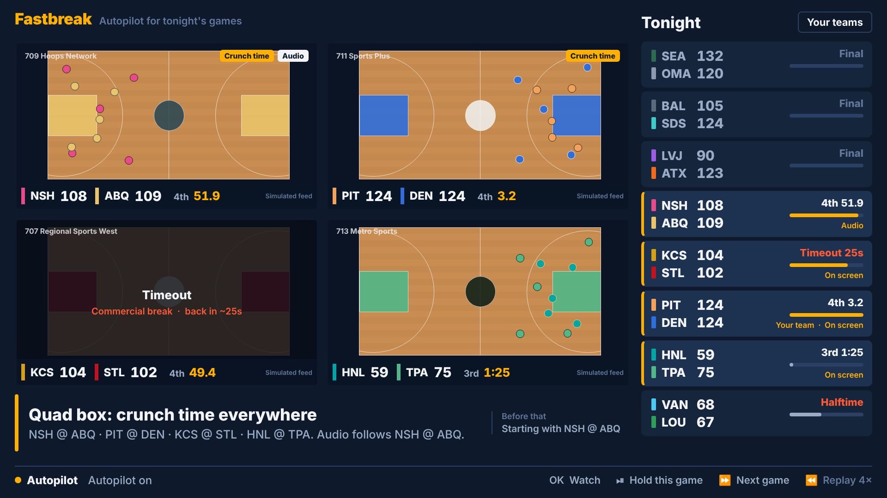

# Fastbreak

**Autopilot for a night of live basketball on Fire TV.** When your game goes to commercial, Fastbreak moves you to the best game that's live. When play resumes, it brings you back. When two or four games go down to the wire at once, it splits the screen, like a RedZone channel built around your own teams.

Built for the Amazon Developer Hackathon (Fire TV track) on **Vega OS** with React Native. The same code also runs in a browser for quick iteration.



## What it does

- **Hops on breaks.** Timeouts, media timeouts, quarter breaks, halftime and replay reviews are detected from the play-by-play feed. Fastbreak switches before the commercial reaches your screen, because the feed runs 25–55 s ahead of the broadcast.
- **Won't hop into a commercial.** If another game's feed already shows a timeout that your stream hasn't reached yet, that game is skipped. While a break lasts, it prefers games that will still be live when the break ends.
- **Comes back.** It remembers the game you were really watching. It returns when play resumes, unless the game it's showing has become clearly better, and the caption tells you which.
- **Finds tight games.** Each game gets a leverage score from a closed-form win-probability model: how much one possession swings the outcome. Combined with your teams and a loyalty setting, this ranks every game every 250 ms.
- **Split and quad.** Two crunch-time games give a split screen; three or more give a quad box. Tiles keep their positions, and audio follows a live game. A tile stuck on a long commercial gets filled with something live.
- **Never thrashes.** Minimum time on a game, a score margin a new game must beat to take over, hysteresis on what counts as must-see, and a delay before the layout shrinks.
- **Explains itself.** Every switch shows a reason, for example *"Media timeout in KCS @ STL. Switching to PIT @ DEN, 4th 5:21, 1-pt game. Back in ~2:45."*

## Remote

| Button | Action |
| --- | --- |
| Up / Down | Browse tonight's games (first press shows focus) |
| OK on a game | Watch it (autopilot still covers its breaks) |
| OK on "Your teams" | Pick favorites, likes, loyalty, split/quad on/off |
| Left into the video | Pick a tile in split/quad; OK makes it full screen |
| Play/Pause | Hold this game (pause autopilot) |
| Fast-forward | Jump to the next best game |
| Rewind | Demo only: cycle replay speed |

On web: arrow keys, Enter, Space (Play/Pause), `]` (Fast-forward), `[` (Rewind), Esc (Back).

## How it works

```
packages/director      pure TypeScript engine, no platform deps (unit tested)
  gameState.ts         play-by-play reducer; feed view vs. on-screen view per channel delay
  winprob.ts           win probability + leverage index
  breakModel.ts        stoppage durations, break hazard (media-timeout windows, runs, late game)
  director.ts          the policy: break hops, anchor/return, upgrades, must-see, split/quad, audio
  lineup.ts            LineupSource / PlaybackController interfaces (EPG + data feed adapters)
  sim/                 deterministic possession-level game simulator for a fictional league
packages/shared-ui/src/fastbreak   the 10-foot UI (stage, tiles, game rail, caption, teams)
apps/vega              Vega OS app shell
apps/expo-multi-tv     web / Android TV shell (used for fast iteration)
```

**On a real device**, `LineupSource` is built from the Vega **EPG Provider** (which channels in your lineup carry tonight's games) plus a licensed sports data feed. `PlaybackController` maps the primary slot to **Vega Channel Tuning**, with additional players for multiview tiles. The demo replays a simulated slate so it carries no league footage or data rights. Teams are fictional, and video tiles are a rendered "broadcast" driven by the feed.

## Run it

Prerequisites: Node 18+, Yarn 4 (`corepack enable`), and for Vega the Vega SDK (`vega --version`) with Java 21+.

```bash
yarn install

# Vega OS (Vega Virtual Device)
vega virtual-device start
yarn build:vega
vega run-app apps/vega/build/aarch64-release/*_aarch64.vpkg -d VirtualDevice   # x86_64 on Intel Macs

# Web (fast iteration)
yarn dev:web            # http://localhost:8082/?seed=74&speed=8

# Engine tests and tools
cd packages/director
npx tsx --test test/*.test.ts
npx tsx scripts/runHeadless.ts 74        # print every decision over a full night
npx tsx scripts/findSlate.ts 1 200       # search for demo-worthy nights
```

Demo knobs are in `packages/shared-ui/src/fastbreak/demoConfig.ts` (default night `74`, 8x replay, starting a few minutes before the first split screen). On web they can be overridden with `?seed=&speed=&start=<seconds>`.

## License

MIT-0. Built on Amazon's [react-native-multi-tv-app-sample](https://github.com/AmazonAppDev/react-native-multi-tv-app-sample) (MIT-0); its original README is in `TEMPLATE_README.md`.
